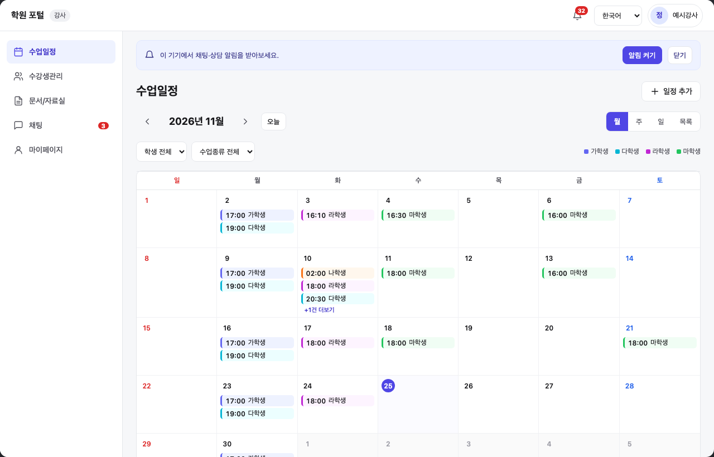
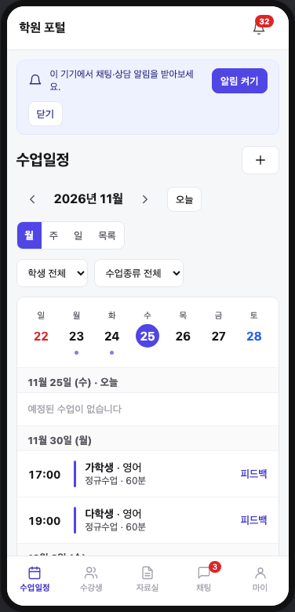
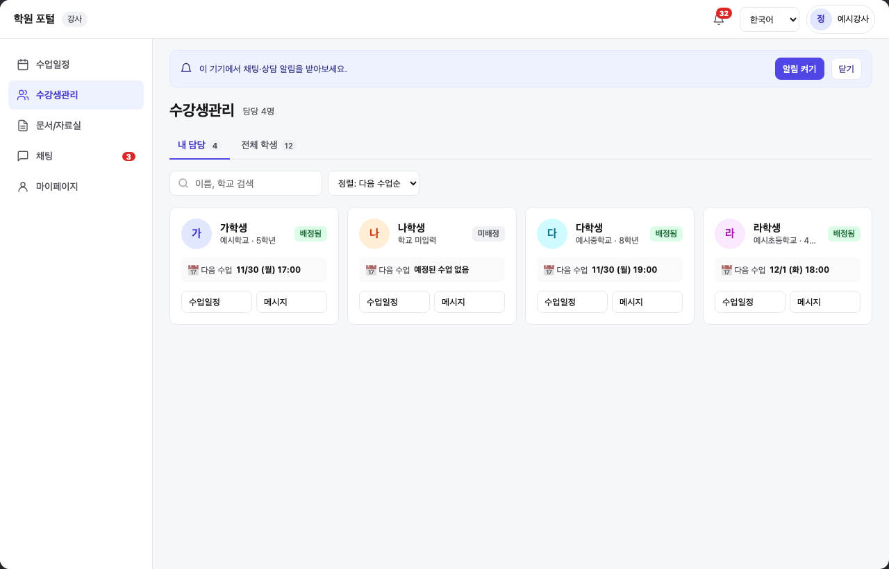
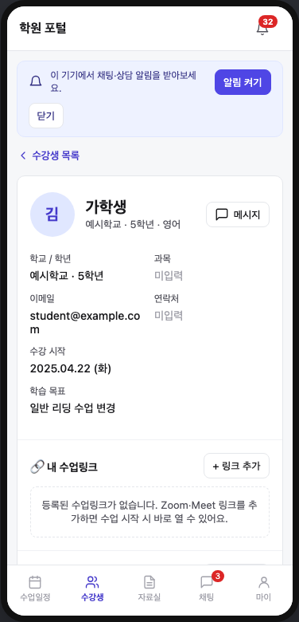
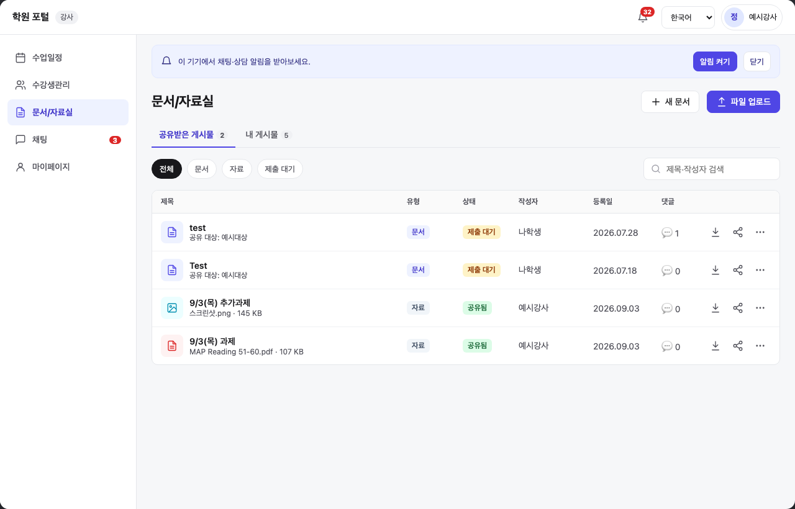
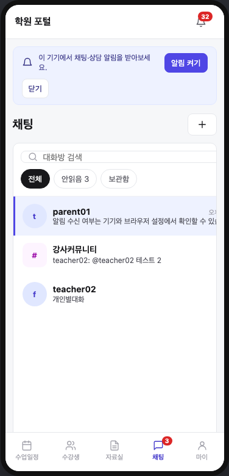
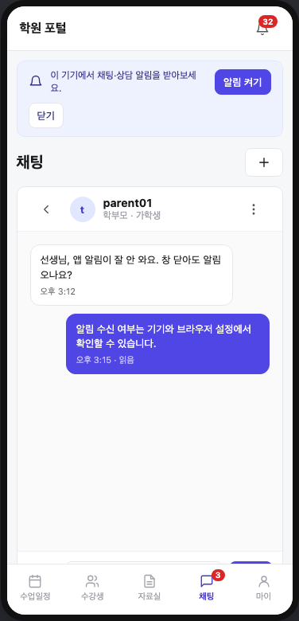
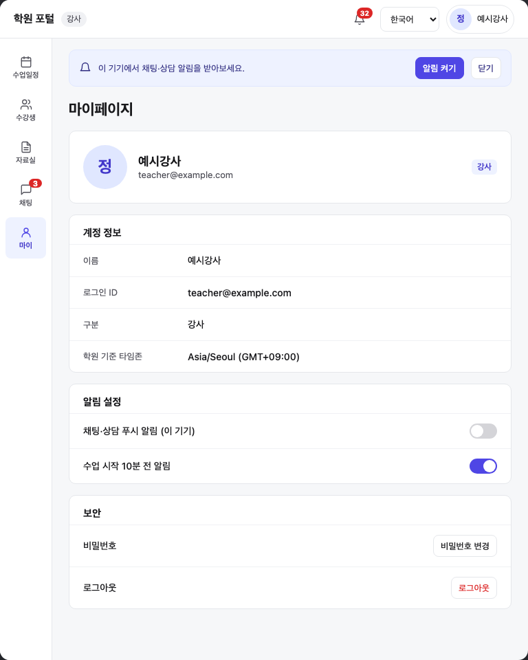

# Academy Portal UI Improvement Proposal (학원포털 UI 개선안)

**검토안 v1.0 · 2026.11.25**

첨부 목업의 반응형 탐색 구조와 화면별 정보 배치를 채택하고, 실제 포털의 역할·테넌트 권한에 맞춰 조정한다. 가장 먼저 **모바일 탐색, 수업일정 가독성, 수강생 조회 범위 명확화**를 개선하고 자료실·채팅·내 정보의 공통 사용성을 정리한다.

이번 산출물은 화면 개선 제안과 작업 계획이다. 운영 애플리케이션의 구현·배포는 포함하지 않는다.

## 1. Scope and Evidence (대상·근거)

| 항목 | 내용 |
| --- | --- |
| 대상 | 로그인 후 학원포털 /portal/*의 강사·학생 화면 |
| 참고 파일 | acm-portal-mockup.html — 1280 / 768 / 375 화면 전환이 있는 HTML 목업 |
| 비교 기준 | 배포 기준 7c17137에 대응하는 frontend-acm의 PortalShell 및 관련 페이지 소스 |
| 시각 검토 | 첨부 목업을 데스크톱·태블릿·모바일로 렌더링하고 8개 장면 캡처 |
| 확인 한계 | 이번 작업에서 운영 계정으로 실제 포털에 로그인해 재현하지 않음. 현재 화면 관련 판단은 소스 기준 |
| 개인정보 | 참고 목업의 이름·이메일을 가상 값으로 바꾼 검토본을 캡처. 원본 파일은 수정하지 않음 |

**목업의 주석·문구·버튼은 제안 자료로 해석했다.** 일정 추가, 전체 학생 조회, 알림 예약 등은 사용자가 확정한 새 기능으로 간주하지 않는다. 기존 요구와 다른 부분은 아래에서 수정 제안한다.

**유지할 기존 요구:** 캘린더는 강사만, 사용자 지정 타임존은 강사·학생 모두 비노출, 퇴원생은 전체보기에서만, 수강생 상세의 특이사항은 비노출, 공지사항은 강사·학생별 테넌트 노출 설정을 적용한다.

<!-- page -->

## 2. Review Summary (목업 평가·채택 판단)

| 목업 요소 | 판단 | 개선안 |
| --- | --- | --- |
| 간결한 헤더·프로필 버튼 | 채택 | 로그인 이메일은 프로필로 이동. 역할·알림·계정 진입 유지 |
| 데스크톱 메뉴 / 태블릿 레일 / 모바일 하단 메뉴 | 조건부 채택 | 고정 5개를 모든 역할에 쓰지 않고 허용 메뉴로 구성. 추가 메뉴는 더보기 |
| 월간 일정의 시간·학생명 칩 | 채택 | 장기 제목과 그룹 수업을 고려해 시간 + 대표 이름 + 추가 인원 표시 |
| 모바일 주간 스트립·일정 목록 | 채택 | 좁은 월 그리드 대신 읽기 쉬운 목록을 기본으로 제공 |
| 모든 보기의 일정 필터 | 채택 | 월·주·일·목록에서 같은 조건 유지 |
| 내 담당 / 전체 학생 탭 | 명칭·의미 수정 | 내 담당 / 전체보기(퇴원 포함). 둘 다 기존 본인 담당 범위 |
| 폴더 대신 학생 요약 카드 | 채택 | 이름·학교·상태 우선. 다음 수업은 조회 데이터 확보 후 추가 |
| 자료실의 데스크톱 표·모바일 목록 | 채택 | 작성·공유·삭제는 기존 권한에 따라 분리 |
| 알림 안내를 인라인으로 이동 | 채택 | 기존 기기 구독·닫기 유예 정책 유지 |
| 일정 추가 버튼 | 기본안에서 제외 | 현재 강사 포털은 조회 중심. 외부 스케줄 앱 배정과 권한 확인 필요 |
| 수업 10분 전 알림 스위치 | 별도 기능 | 예약 발송·대상·취소·중복 방지 설계 후 도입 검토 |
| Zoom·Meet 링크 예시 | 문구 수정 | 테넌트에서 지원하는 화상 제공자·기존 링크 정책에 맞춤 |
| 한국어·영어만 표시 | 수정 | 기존 한국어·영어·베트남어·중국어 지원 유지 |
| 채팅·검색·필터 버튼 | 동작 확인 필요 | 목업은 일부 버튼만 작동. 실제 검색·전송 기능 구현 완료로 해석하지 않음 |

목업은 탐색과 정보 밀도의 방향을 잘 보여준다. 실제 적용에서는 **권한, 데이터 제공 범위, 화면 상태, 작은 화면의 조작 크기**를 보완해야 한다.

**범위 구분:** 관리자 업무관리에서 사용하지 않기로 한 기존 문서 메뉴와 포털의 문서/자료실은 서로 다른 기능이다. 이번 포털 개선에서 기존 자료실을 자동으로 제거하거나 업무목록 링크로 대체하지 않는다.

<!-- page -->

## 3. Navigation and Roles (공통 레이아웃·역할별 탐색)

### 3.1 Proposed Layout (화면 구성안)

~~~text
Desktop ≥ 1024
┌ 학원명·포털 | 역할                   알림 · 언어 · 프로필 ┐
├ 좌측 메뉴 240 ┬ 페이지 제목 · 설명 · 주요 작업              ┤
│ 허용 메뉴만   │ [필요할 때만 기기 알림 안내]                │
│ 현재 위치 강조│ 기간·보기 전환 / 공통 필터                   │
│              │ 화면별 본문                                  │
└──────────────┴──────────────────────────────────────────────┘

Tablet 640~1023 : 76px 메뉴 레일 + 확장 가능한 본문
Mobile < 640   : 상단 헤더 + 본문 + 허용 메뉴 기반 하단 탐색
~~~

목업의 220px 사이드바는 프로젝트 공통 토큰인 240px로 맞춘다. 본문은 1440px 이내 가용 폭을 사용하되 내 정보는 680px, 읽기 중심 상세는 약 960px로 제한한다. 헤더는 기본 56px를 목표로 하고 긴 이름·번역·확대 시 높이 확장을 허용한다.

| 메뉴 | 강사 | 학생 | 적용 기준 |
| --- | --- | --- | --- |
| 수업일정 | 허용 시 표시 | 표시·직접 목록 진입 제한 | 기존 강사 전용 정책 |
| 수강생관리 | 허용 시 표시 | 제한 | 기존 담당 학생 범위 |
| 수업링크 | 기존 역할 정책에 따름 | 허용 시 표시 | 학생의 주요 수업 진입 |
| 문서/자료실 | 허용 시 표시 | 허용 시 표시 | 작성·공유 대상은 기존 정책 |
| 채팅 | 허용 시 표시 | 제한 | 학생에게 신규 채팅 권한을 부여하지 않음 |
| 공지사항 | 강사 설정 적용 | 학생 설정 적용 | 테넌트별·역할별 독립 설정 |
| 마이페이지·로그아웃 | 항상 접근점 유지 | 항상 접근점 유지 | 계정 관리 |

**모바일 강사 기본안:** 수업일정 / 수강생 / 자료실 / 채팅 / 더보기. 더보기에는 허용된 공지사항과 마이페이지를 배치한다. 숨긴 메뉴는 제외하며 허용 메뉴가 적으면 빈 칸 없이 재배치한다. 프로필 버튼에서도 마이페이지로 이동할 수 있다.

**학생 기본안:** 수업링크 / 자료실 / 마이페이지. 공지를 켠 학원만 공지사항을 추가한다. 학부모는 기존 정책을 별도 유지하며 학생 설정에 합치지 않는다.

**설정 상태:** 메뉴 로딩·실패 시 임의로 전체 메뉴를 보여주지 않는다. 계정 관리 진입과 재시도를 제공한다. 메뉴 노출 제한은 직접 URL·API 권한 검사와 함께 유지한다. 기존 포털 메뉴 갱신·동기화 동작도 보존한다.

<!-- page -->

## 4. Calendar (수업일정 — 먼저 읽고 바로 들어가기)

<figure><figcaption>첨부 목업 · 데스크톱. 운영 화면 캡처가 아님.</figcaption></figure><figure><figcaption>첨부 목업 · 모바일. 가상 값으로 치환.</figcaption></figure>

**소스에서 확인한 점:** 월·주·일·목록 보기와 상세는 이미 있다. 학생·수업종류 필터는 월 보기에서 숨겨진다. 월 그리드의 초과 일정 더보기는 이미 있으므로 신규 기능으로 중복 개발하지 않는다.

1. 제목을 **수업일정**으로 명확히 표시한다.
2. 기간 이동·오늘·보기 전환을 첫 줄에, 학생·카테고리 필터를 다음 줄에 공통 배치한다.
3. 월간 칩은 **17:00 가학생**, 그룹은 **17:00 가학생 외 2명**처럼 표시한다. 잘린 제목은 상세에서 확인할 수 있게 한다.
4. 학생별 색은 보조 식별 수단으로 쓰고 이름·종류를 함께 보여준다. 3건 초과는 기존 더보기 동작을 일관되게 유지한다.
5. 모바일은 주간 날짜 스트립 + 선택일 목록을 기본안으로 제안한다. 월·주·일·목록 선택은 유지하고 사용자가 명시적으로 바꾼 보기를 존중한다.
6. 상세로 이동했다 돌아와도 날짜·필터·스크롤을 유지한다. 화면 크기가 바뀌었다고 선택한 날짜를 오늘로 초기화하지 않는다.

**상태 설계:** 불러오는 중 / 오늘 일정 없음 / 필터 결과 없음 / 조회 실패·재시도를 구분한다. 로딩 중 잠깐 빈 일정이라고 표시하지 않는다.

**정책 보완:** 목업의 보강·상담은 실제 카테고리 계약과 대응한 뒤 표시한다. 현재 계약인 회의·레벨테스트·데모·정규·기타를 임의의 enum으로 바꾸지 않는다. 날짜·시간 변환은 기존 학원 및 저장된 사용자 시간대 정책을 유지한다. 사용자 지정 타임존 입력란을 복원하지 않는다.

**일정 추가:** 기본 UI 개선안에는 넣지 않는다. 외부 스케줄 앱에서 배정된 수업은 출처와 대면 방식을 확인할 수 있게 하되, 포털의 편집 권한을 새로 부여하지 않는다.

<!-- page -->

## 5. Students (수강생 — 담당 범위와 상태 명확화)

**소스에서 확인한 점:** 현재는 폴더 아이콘의 이름 카드와 전체보기 체크박스이다. includeWithdrawn=false가 기본이며 전체보기에서도 본인 담당 범위만 조회한다.

| 개선 항목 | 제안 |
| --- | --- |
| 탭 명칭 | **내 담당 / 전체보기(퇴원 포함)**. 학원 전체 학생 조회로 오해하지 않게 설명 |
| 기본 목록 | 기존처럼 WITHDRAWN 제외. INACTIVE를 퇴원으로 바꾸어 해석하지 않음 |
| 전체보기 | 기존 담당 범위에서 퇴원생 포함, 퇴원 상태를 텍스트 배지로 표시 |
| 카드 | 이름·영문명 → 학교/학년·과목 → 상태 → 허용된 상세 이동 |
| 검색 | 이름·영문명·학교 검색. 필터 결과 수와 초기화 제공 |
| 정렬 | 우선 이름순. 다음 수업순은 필요한 데이터가 준비된 단계에서 제공 |
| 인원수 | 각 탭과 검색 결과의 집계 기준을 구분. 임의 고정 숫자 사용 금지 |
| 다음 수업 | 묶음 조회로 확보 후 제공. 날짜·시간·없음·조회 실패를 구분 |

**중요한 보완:** 목업의 ‘내 담당 4 / 전체 학생 12’는 적용하지 않는다. 전체보기를 켰다고 다른 강사 담당 학생까지 볼 수 있어서는 안 된다.

**행동:** 기본안은 카드 전체를 상세 링크로 제공한다. 다음 수업·메시지 단축 버튼은 실제 대상 연결과 권한을 확인한 경우에만 표시한다. 카드 내부 버튼을 누르면 상세도 함께 열리는 중복 동작이 없도록 한다.

**데이터 구분:** 배정 관계·재원 상태·다음 수업 유무는 서로 다른 상태이다. 일정이 없다는 이유로 미배정, INACTIVE라는 이유로 퇴원이라는 배지를 붙이지 않는다.

<!-- page -->

## 6. Student Detail (수강생 상세 — 정보와 수업 행동 연결)

<figure><figcaption>참고 목업 · 모바일 상세. 권한·기능은 별도 검토 대상.</figcaption></figure>
<h3>권장 정보 순서</h3><ol><li>목록 복귀·이름·학교·상태</li><li>학교/학년·과목·이메일·연락처·수강 시작</li><li>학습 목표</li><li>내 수업링크</li><li>상담 기록</li><li>최근 수업 기록·피드백 상태</li></ol>
특이사항 항목은 계속 숨깁니다. 개인정보 표시 범위는 현재 포털 API 계약을 유지합니다.

**날짜·빈 값:** 수강 시작은 날짜 형식으로 통일하고 ISO 원문을 그대로 노출하지 않는다. 날짜 전용 값은 시간대 변환으로 하루가 바뀌지 않게 처리한다. 단순 누락은 미입력, 해당 없음·권한 없음은 실제 의미에 맞는 문구를 쓴다.

**수업링크:** 기존 linksEditable에 따라 추가·수정 버튼을 표시한다. ‘Zoom·Meet 링크를 추가’라는 목업 문구를 모든 학원에 고정하지 않고 **등록된 수업링크가 없습니다** 등 실제 지원 정책에 맞춰 쓴다.

**기록:** 수업 기록의 예정·피드백 미작성·완료 상태를 구분한다. 피드백 작성·전체 보기는 기존 접근 가능한 화면에 연결하고, 미래 수업에 완료·피드백 작성 버튼을 무조건 표시하지 않는다.

**정합성:** 학생이 속한 화면 제목의 과목과 상세의 과목이 서로 다르지 않게 같은 데이터 기준을 사용한다. 목업의 모든 학생 카드가 같은 상세를 열어 주는 동작은 실제 기능으로 채택하지 않는다.

**완료 기준:** 특이사항 라벨·값·API 필드가 계속 비노출이고 학습 목표·기존 관리자 기록은 유지된다. 목록 복귀 시 전체보기·검색·페이지 상태가 복원된다.

<!-- page -->

## 7. Materials (문서/자료실 — 탐색과 관리 구분)

**소스에서 확인한 점:** 공유받은 게시물 / 내 게시물과 문서·자료 필터, 페이지네이션, 작성·공유 기능이 있다. 현재는 카드 목록이며 검색·제출 대기 필터는 별도 데이터 계약 검토가 필요하다.

**구성안:** 제목·주요 작업 → 1차 탭 → 유형 필터·검색 → 표/목록 → 페이지 이동. 상단의 주 작업은 파일 업로드를 강조하고 새 문서는 보조 버튼으로 둔다. 작성 권한과 탭 맥락이 허용하는 경우에만 노출한다.

| 화면 | 표시 내용 |
| --- | --- |
| 데스크톱 | 제목·유형·상태·작성자·등록일·댓글·작업 |
| 태블릿 | 제목·상태·등록일 우선, 보조 정보는 제목 아래 또는 상세 |
| 모바일 | 제목·유형/상태·작성자/등록일을 세로 목록으로, 더보기 작업 |

**필터:** 탭은 공유 범위, 칩은 콘텐츠 유형으로 역할을 구분한다. 제출 대기는 제출 상태를 실제로 판별할 수 있는 문서에만 제공하며 파일 공유 상태와 섞지 않는다. 검색은 전체 결과에 적용되어야 하며 현재 페이지만 검색한다면 그 범위를 명시한다.

**권한:** 다른 사람이 공유한 자료에 수정·공유·삭제를 일괄 표시하지 않는다. 문서에는 열기, 첨부 파일에는 다운로드 등 실제 가능한 작업을 구분한다. 삭제는 더보기와 확인 절차로 제공한다.

**데이터:** 검색·정렬·집계가 서버 페이지네이션과 일치하도록 설계한다. 내 게시물 수·공유받은 게시물 수를 현재 페이지 항목 수로 잘못 표시하지 않는다.

<!-- page -->

## 8. Chat and Notifications (채팅·알림 — 가림과 복귀 문제 해소)

<figure><figcaption>목록: 검색·읽지 않은 수·최근 시간</figcaption></figure><figure><figcaption>대화: 뒤로가기·입력창·전송</figcaption></figure>

**채팅:** 데스크톱은 대화 목록과 대화방 2열, 모바일은 목록 → 대화방 전환으로 제안한다. 뒤로가기는 먼저 목록으로 복귀하고 선택·검색·스크롤을 유지한다. 대화방 선택과 URL/브라우저 뒤로가기를 일치시킨다.

**주요 상태:** 대화 없음, 메시지 로딩, 전송 중, 전송 실패·재전송, 연결 끊김·재연결을 구분한다. 읽지 않은 수는 실제 데이터에서 갱신하고 99+ 등 표시 상한을 둔다. 검색·안읽음 필터·보관함은 실제 지원 범위에 맞춰 단계적으로 제공한다.

**모바일 입력:** 키보드가 열려도 입력창·전송 버튼을 볼 수 있게 한다. 780px 고정 높이 대신 100dvh와 safe-area를 고려한다. 대화방 내부에서는 하단 메뉴를 접고 뒤로가기와 상단 계정 접근을 유지하는 안을 제안한다.

**알림:** 기기 알림 안내는 본문 위 인라인으로 배치해 자료·입력창을 가리지 않게 한다. 기존 닫기 유예와 기기 구독 정책을 재사용한다. 알림이 차단되었으면 브라우저 설정 안내, 미지원이면 해당 상태를 표시한다. 단순 스위치 ON으로 권한 허용을 보장하지 않는다.

**목업 문구 수정:** ‘창을 닫아도 반드시 알림이 온다’는 표현은 쓰지 않는다. 수신은 지원 환경·설정에 따라 달라진다고 안내한다. 수업 10분 전 알림은 예약 발송이 필요한 별도 기능이며 이번 기본안에 켜진 스위치로 넣지 않는다.

<!-- page -->

## 9. Profile and Visual Rules (마이페이지·시각 기준)

**마이페이지:** 680px 이내 프로필 카드 → 계정 정보 → 지원되는 기기 알림 설정 → 보안·로그아웃 순서로 정리한다. 이메일은 줄바꿈을 허용한다. 강사·학생의 사용자 지정 타임존은 계속 숨긴다. 학원 기준 타임존은 표시 필요성이 있을 경우 읽기 전용으로 제안하며 기존 저장값·변환 정책은 바꾸지 않는다.

**보안 버튼:** 비밀번호 변경은 실제 인증 방식에서 지원하는 계정에 제공한다. 로그아웃은 계정 관리 안에서 항상 찾을 수 있게 하고 기존 푸시 연결 정리와 로그인 이동을 유지한다.

| 요소 | 제안 기준 |
| --- | --- |
| 색상·브랜드 | 공통 accent·surface·border 토큰 재사용, 학원 브랜딩은 설정값 |
| 본문 | 14~16px, 기본 행간 약 1.5. 작은 회색 글씨에 핵심 정보 배치 금지 |
| 제목 | 페이지 20~24px, 섹션 16~18px |
| 간격·모서리 | 4/8px 간격 체계, 카드 약 8~12px |
| 조작 크기 | 주요 모바일 버튼·메뉴의 터치 영역 44×44px 이상 목표 |
| 대비 | 일반 본문 4.5:1 이상을 검수 목표로 설정 |
| 아이콘 | Lucide 기반, 아이콘 전용 버튼은 접근 가능한 이름과 툴팁 |
| 포커스 | 키보드 포커스 표시, 현재 메뉴 aria-current, 탭·대화상자 키보드 동작 |
| 번역 | ko/en/vi/zh-CN, 긴 번역에서 줄바꿈·레이아웃 확인 |

목업의 연한 회색 글씨와 32~40px 버튼은 실제 적용 전 대비·터치 영역을 보완한다. 강제 한 줄 헤더와 11px 주요 정보는 확대·작은 화면에서 재검토한다.

<!-- page -->

## 10. Delivery and Acceptance (우선순위·완료 기준)

| 단계 | 작업 | 선행 조건·범위 |
| --- | --- | --- |
| P0: 탐색·권한 | 공통 셸, 동적 메뉴, 헤더, 모바일 탐색, 기존 비노출 정책 회귀 확인 | 메뉴·권한 계약 재사용 |
| P1: 핵심 화면 | 일정 제목·공통 필터·모바일 목록, 수강생 탭·카드·상세 날짜 정리 | 기존 조회 데이터 우선 |
| P1: 콘텐츠 사용성 | 자료실 표/목록, 모바일 채팅 전환, 프로필·인라인 알림 | 기존 작성·공유·푸시 정책 유지 |
| P2: 데이터 확장 | 다음 수업 묶음 조회·정렬, 전체 결과 검색·집계, 지원되지 않는 채팅 필터 | API·성능·권한 검토 후 별도 작업 |
| 별도 기능 검토 | 수업 사전 알림 예약, 포털에서 일정 추가·배정 | 신규 요구 확정·설계 필요 |

**검수 시나리오**

- 강사는 허용된 캘린더를 보고 학생은 메뉴·직접 목록 진입이 제한된다.
- 공지사항 ON/OFF 네 조합이 강사·학생에 각각 적용되고 모바일 더보기에도 일치한다.
- 퇴원생은 기본 목록에 없고 전체보기에서만 본인 담당 범위 안에 나타난다.
- 특이사항·사용자 지정 타임존은 다시 노출되지 않는다.
- 375/390/640/768/1024/1280 폭에서 메뉴·본문이 잘리지 않는다.
- 200% 확대·키보드·긴 이름·그룹 수업·긴 번역을 처리한다.
- 일정 없음 / 필터 없음 / 조회 실패가 구분된다.
- 자료실 페이지·검색·권한이 일치하고 위험 작업은 확인 절차가 있다.
- 모바일 대화방에서 키보드·뒤로가기·전송 실패 복구가 동작한다.
- 다른 학원·다른 역할의 캐시와 화면 데이터가 섞이지 않는다.

**추천 적용 순서:** 공통 셸과 역할별 메뉴를 먼저 확정하고 수업일정·수강생 화면을 적용한 뒤 자료실·채팅·마이페이지로 확장한다. API가 필요한 편의 기능은 분리해 UI 변경만으로 기능이 생긴 것처럼 표시하지 않는다.

## 11. References (참조)

- [작업 계획·화면 구성 시안](../plan/PLN-261125-portal-ui-improvement.md)
- [참고 목업 검토 화면·제안서 HTML](../design/portal-ui-review-261125/index.html)
- [기존 강사 캘린더·퇴원생·타임존 요구](REQ-261124-teacher-portal-calendar.md)
- [기존 포털 메뉴·공지·특이사항 요구](REQ-261125-portal-menu-visibility.md)
- [현재 스타일 가이드](../standard/STYLE_GUIDE.md)
- 소스: portal-shell.tsx, portal-calendar-page.tsx, portal-teacher-students-page.tsx, portal-materials-page.tsx, my-profile-page.tsx, use-portal-menus.ts, push-settings.tsx.
\n\nImplementation status (구현 상태): 2026-11-25 사용자의 “진행” 승인으로 핵심 UI를 구현했다. 구현·검증 범위와 선택 확장 제외 항목은 [구현 보고서](../report/RPT-261125-portal-ui-improvement.md)를 참조한다. 스테이징·운영 반영과 15분 관찰을 완료했으며 [배포 보고서](../report/RPT-261125-portal-ui-production-deploy.md)를 참조한다.\n