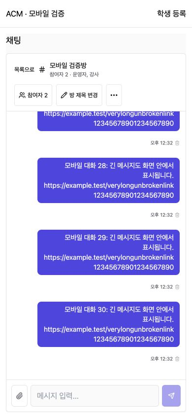
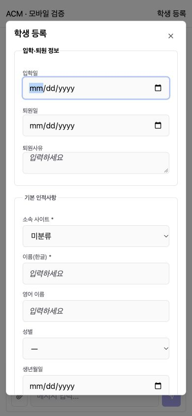

# Admin Mobile Improvement (관리자 모바일 개선)

## 1. Changes (변경)
- 채팅의 콘텐츠 폭 640px 세로 배치 및 최소 560px 강제 규칙 제거. 화면 768px 기준 방 목록/대화 전환 유지.
- visualViewport 높이와 채팅 시작 위치를 측정하여 입력창이 보이는 영역에 남도록 배치. 메시지 영역 min-height:0/독립 스크롤, 입력 영역 축소 방지 및 safe-area 적용.
- 새 메시지 수신 시 페이지 전체 scrollIntoView 대신 메시지 목록만 스크롤.
- 긴 URL/메시지 줄바꿈, 모바일 방 제목과 관리 버튼 줄바꿈, 터치 버튼 44px 적용.
- 모바일 참여자 목록을 Dialog로 표시. 관리자 권한·일반 참여자 DM 노출 규칙 유지.
- 관리자 공통 우측 패널은 모바일에서 버튼으로 여는 Dialog로 제공. 데스크톱 표시 선호는 보존.
- 공통 모달 dvh 높이/내부 스크롤/44px 닫기 버튼/버튼 줄바꿈. 관리자 개별 팝업 21곳의 vh 재정의도 dvh로 변경.
- 상담·학생·학부모·직원·수납·일정·학교·참고자료·문항 폼의 고정 2열을 모바일 1열로 수정하고 해당 col-span 보정.
- 학부모 검색 고정 폭 완화, 고객불만 제목/작업 버튼 줄바꿈, 공통 헤더 간격 축소, 입력 폰트 16px 및 컨테이너 최소 폭 보정.
- 업무 표/달력의 기존 영역 가로 스크롤은 유지. 수납 그래프 3개 한 줄 요구도 유지.

## 2. Coverage (화면 범위)
| 영역 | 검토/적용 |
|---|---|
| 채팅 | 실제 컴포넌트 합성 데이터 브라우저 검증, 모바일·데스크톱·강사 모드 |
| 학생/학부모 | 폼 1열, 검색 폭, 학생 등록 모달 브라우저 검증 |
| 상담/직원/일정/수납 | 폼 배치와 공통 패널·팝업 적용, 코드 점검 |
| 학교/자료/문항 | 폼 배치 및 팝업 적용, 코드 점검 |
| 강사/수업/수강 | 공통 패널·모달 및 해당 팝업 높이 개선 |
| 대시보드/통계 | 기존 반응형 카드·영역 스크롤 점검, 공통 헤더/입력 스타일 적용 |
| 게시글/알림/Q&A/설정/고객불만 | 기존 영역 표 스크롤·반응형 폼 유지, 공통 패널/팝업 및 고객불만 제목 적용 |

## 3. Browser Verification (브라우저 검증)
Chrome 로컬 합성 fixture 사용. API adapter로 요청을 전부 가로채며 운영 메시지/학생 데이터 저장 없음.
- 320/360/390/430/768/1024/1280px에서 대화·입력창 폭과 하단 위치 확인.
- 휴대폰 740px 높이에서 입력 하단 721px. 높이 400px 모사에서 입력 하단 381px, 화면 가로 넘침 없음.
- 390×844 실제 브라우저 viewport override에서도 대화/입력창 확인.
- 방 목록 복귀 후 방 재선택, 참여자 열기/닫기, 방장 관리 버튼 노출 확인.
- 강사 일반 참여자는 참여자/DM만 표시, 초대/강제 내보내기 미노출 확인.
- 공통 보조 패널 모바일 Dialog 열기, 학생 등록 폼 1열 및 가로 넘침 없음 확인.
- 학생 모달: 폭366px, clientWidth/scrollWidth364px, 내부 스크롤 제공.
- TypeScript/Vite build 통과. 기존 대형 청크 경고는 남아 있음. lint 스크립트는 placeholder이므로 lint 통과로 보고하지 않음.

## 4. Evidence (증빙)

측정 결과: assets/admin-mobile-261013/viewport-results.json.
재검증 fixture: frontend-acm/test/mobile-admin-matrix.html 및 mobile-admin-fixture.html.

## 5. Limitations (검증 범위와 제한)
운영 모바일 로그인 세션에서 최초 미노출 현상을 재현하지는 못했다. 코드상 충돌 높이/배치와 합성 데이터에서 확인한 메시지 넘침·전체 페이지 스크롤을 수정했다.
실제 iOS Safari/Android Chrome 기기·소프트 키보드 검증은 미실시. 400px 검증은 viewport 축소 모사이며 실제 OS 키보드 테스트가 아니다.
모든 메뉴의 개별 생성·수정·저장 업무를 브라우저에서 전수 실행하지 않았다. 공통 컴포넌트 및 대표 동선을 확인하고 나머지는 코드 점검했다.
백엔드/API/DB 변경 없음. 운영 미배포.
