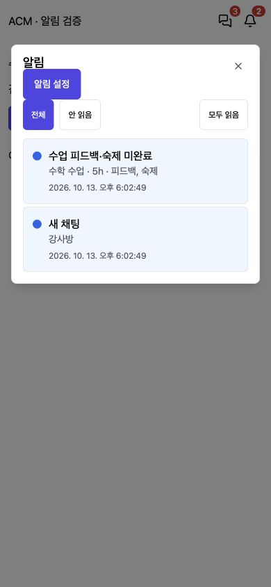
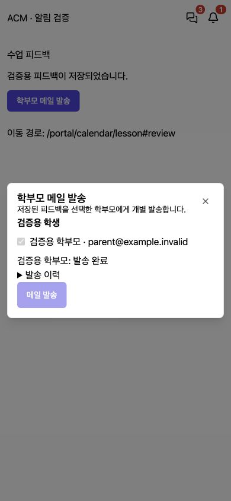
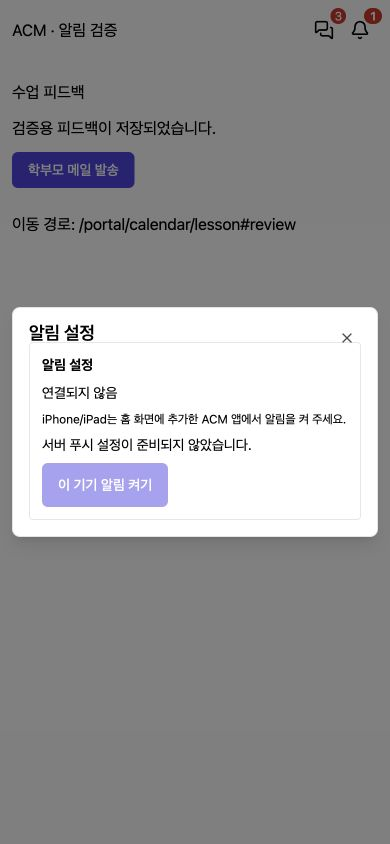

# Notification Delivery and Teacher Feedback (알림 전달·강사 피드백)

## 1. Result (구현 결과)
사용자가 숙제 완료 기준과 진행을 승인하여 아래 기능을 구현했다. 2026-10-13 운영 배포와 서버 검증을 완료했다.

- 채팅 일반 텍스트/파일도 개인 알림함에 적재. 멘션 수신자는 일반 메시지 알림에서 제외하여 중복 방지. 관리자/강사 포털의 모바일 헤더에 미확인 채팅 수, 종에 미확인 알림 수 표시. 강사 메뉴에도 채팅 수 표시.
- 실제 표시되고 포커스가 있는 방에서 최신 메시지까지 확인한 경우에만 읽음 처리. 표시된 메시지의 서버 타임스탬프를 읽음 경계로 사용하며 단조 증가. 발신 자체로 읽음 처리하지 않음. 메시지 저장 시각은 채널 잠금 획득 후 clock_timestamp()로 기록.
- 읽음 처리와 outbox 전달 순서가 뒤바뀌어도 이미 읽은 메시지는 미확인으로 다시 적재하지 않음. 상담·일정 알림과 별도로 채팅 알림 읽음 동기화.
- 토스트/종/푸시 클릭 시 해당 채팅방·메시지 또는 상담/수업 상세로 이동. OS 푸시 클릭에는 알림 ID를 포함하여 로그인 후 권한 재검증·읽음 처리. 해당 기기 푸시가 연결된 관리자 계정은 SSE 토스트 중복 억제.
- 기기 알림 설정, Web Push 구독/해지, Service Worker, 설치 manifest와 중립 ACM 아이콘 추가. 로그인 계정 변경/로그아웃 시 기기 연결 정리, 수신 당시 계정 불일치 푸시 무시. API/업무 데이터의 오프라인 캐싱 없음.
- Web Push는 구독 후 생성된 미확인 알림에만 적용. 수신자·현재 원본 접근 권한 재확인, 만료 구독 정리, 일시 실패 재시도/최대 5회, 동일 알림 tag/topic으로 중복 표시 최소화. 잠금 화면에는 개인정보 대신 일반 안내 표시. 기존 AMA 전달 유형은 확대하지 않음.

## 2. Lesson Reminders (수업 후 미완료 알림)
- 캘린더 수업 종류 CLASS/REGULAR_CLASS/DEMO_CLASS, 담당강사가 지정된 미삭제 회차의 예정 종료 시각 기준. 개인/행사/기타 일정은 제외.
- 종료+5시간/종료+10시간에 숙제 또는 피드백 미완료이면 담당 강사 포털과 같은 학원 활성 ADMIN/APP_ADMIN에게 알림. 1분 주기 확인이며 정상 동작 시 기준 시각 직후 다음 작업에서 생성.
- 확정 기준: 피드백 실제 내용 저장 AND (숙제 내용 OR 유효한 HOMEWORK 첨부 OR ‘숙제 없음’ 명시). 빈 에디터 HTML은 미완료. 작성 행 자체가 없는 수업도 검사.
- 단계별 유니크 기록·트랜잭션·SKIP LOCKED로 중복 방지. 5시간 후 완료되면 10시간 알림 미발송. 복구 시 이미 10시간 경과한 수업에는 최신 단계만 발송.
- 완료·취소(soft delete)·담당자 변경·종료 시각 변경 시 늦게 전달되는 푸시는 전송 직전 재확인하여 억제.
- 마이그레이션 활성화 시각 이후 종료되는 수업부터 적용. 이전 모든 수업에 소급 대량 발송하지 않음.
- 기존 CLS의 24h SLA는 내부 이벤트만 발생하며 이번 CAL 알림과 별도이다.

## 3. Teacher Parent Email (강사 학부모 메일)
- 강사 포털 수업 상세 피드백 영역 하단 ‘학부모 메일 발송’ 버튼. 저장 후 연결 학부모 선택, 개별 메일 발송, 성공/실패/이메일 없음, 실패 대상 재발송, 최근 발송 이력 제공.
- 강사 전용 API는 현재 담당강사 여부와 수업 접근을 서버에서 검사하고 기존 메일 서비스를 재사용. 수업 학생의 연결 학부모만 수신 가능하며 임의 외부 이메일·학부모 연결 수정·알림톡 권한을 추가하지 않음.
- 미저장/변경된 피드백의 오발송 방지를 위해 저장 버전을 검증하고 저장된 내용 스냅샷으로 보냄. 피드백만 포함하고 숙제 자동 발송은 없음.
- 요청 ID로 중복 클릭/재시도 재발송 방지. 응답이 불확실한 전송은 자동 재발송하지 않고 이력에 진행 중/결과 미확인 표시. 명시적인 재발송은 새 요청으로 구분.
- DB 감사 기록: 담당 강사·수업·수신 대상·시각·저장 버전·본문 해시·전송 결과. 실제 학부모에게 개발 중 메일 발송하지 않음.

## 4. Verification (검증)
- Backend 전체: 105 suites / 830 tests 통과. 이후 읽음 처리/푸시 클릭 최종 변경에 대해 관련 3 suites / 32 tests 재검증 통과.
- Backend TypeScript 및 Nest build, frontend TypeScript/Vite build 통과. 기존 대형 번들 경고 유지. 프론트 lint는 기존 placeholder로 실제 lint 결과를 주장하지 않음.
- Backend 변경 파일 ESLint: 오류 0. 테스트 mock의 require-await 등 경고는 별도 남아 있음.
- PostgreSQL 격리 DB `acm_lifecycle_test_notifications_261013`: 기존 inbox 회귀 스크립트 및 신규 검증 스크립트 통과. 5h/10h 경계·행 미생성·완료·비수업 제외·중복·강사 범위·바로가기·읽음/전달 경합·단조 경계·완료 후 지연 푸시 억제·메일 claim/감사 레코드 검증. 합성 테넌트 정리.
- Service Worker 단위 검증 4건: 알림 tag, 로그아웃/계정 불일치 차단, 정확한 내부 경로, 외부 경로 거부 통과.
- 실제 Chrome 390×844, API adapter로 모든 요청을 가로챈 합성 화면: 채팅3/종2, 미완료 항목/5h 표시, 클릭 후 종1 및 수업#review 이동, 학부모 선택 전 발송 비활성/선택 후 활성, 합성 성공 응답 후 중복 클릭 비활성, 설정 미구성 안내 확인.
- 재실행: `backend/test/notification-inbox-pg-check.ts`, `backend/test/notification-delivery-pg-check.ts`, `frontend-acm/test/push-worker.test.cjs`, `frontend-acm/test/notification-delivery-fixture.html`.

## 5. Evidence (로컬 합성 화면)

## 6. Deployment and Limits (배포 및 검증 제한)
- PR [#317](https://github.com/amoeba-devops/appAcademy2/pull/317), 구현 커밋 `3fe3ddc`. 기반 운영 버전 a95390c. 작업 브랜치 feat/notification-delivery-261013. 기존 IDE의 미커밋 소스는 수정하지 않고 독립 복제본에서 작업; 문서·화면 증빙만 복사.
- 기존 talk/inbox 스키마 이후 `sql/acm/1030-notification-delivery.sql` 적용. 알림 유형 확장, 지연 알림 단계 기록, 메일 발송 기록, Push 구독/전달 기록, 메시지 저장 시각 기본값 변경. 운영 DB 백업 후 스테이징 검증을 거쳐 적용 완료.
- Backend 환경 변수 `WEB_PUSH_PUBLIC_KEY`, `WEB_PUSH_PRIVATE_KEY`, `WEB_PUSH_SUBJECT` 모두 설정해야 기기 푸시 활성화. production/staging compose와 예제 환경 파일에 연결. VAPID 키는 최초 한 번 발급 후 재사용하고 private key는 운영 비밀 설정으로 보관. 코드/보고서에 키 값 없음.
- 키 미구성 상태에서도 종 알림/읽음/메일 기능은 동작하며 기기 알림 설정에는 준비되지 않음 안내. 운영·스테이징에 각각 별도 키를 생성해 비밀 환경 파일에 저장하고 컨테이너 내 유효성을 확인함.
- 실제 iOS/Android 기기 및 잠금/앱 종료 후 푸시 수신, 실제 SMTP 공급자 전송은 미검증. 사용 기종/브라우저/설치 방식 답변 미수신. iOS는 홈 화면 웹 앱에서 사용자 동작으로 권한을 허용해야 함: [Apple](https://developer.apple.com/documentation/usernotifications/sending-web-push-notifications-in-web-apps-and-browsers).
- 브라우저/OS가 알림을 지연·차단하거나 기기가 오프라인일 수 있으므로 서버 기준 알림함·배지가 최종 상태다. SMTP 전송 후 프로세스 장애처럼 결과가 불확실한 경우 이력 확인이 필요하다.
- Library reference: [web-push](https://github.com/web-push-libs/web-push).

## 7. Production Deployment (운영 배포 기록)
- PR #317 병합 커밋: `2957094c0c93f355be1b96fb7c3b2e6848f7aaf7` (`2957094`).
- 운영 배포: **2026-10-13 20:27:37 KST / 18:27:37 ICT**. 이전 운영 이미지 `a95390c`는 롤백 기준.
- [PR CI](https://github.com/amoeba-devops/appAcademy2/actions/runs/38389169802), [병합본 CI](https://github.com/amoeba-devops/appAcademy2/actions/runs/38389856685), [스테이징](https://github.com/amoeba-devops/appAcademy2/actions/runs/38389856645), [운영 배포 및 smoke](https://github.com/amoeba-devops/appAcademy2/actions/runs/38390290295) 모두 성공.
- 운영 백업: `/home/appacademy/app-academy-backups/db_acm-before-notification-delivery-20261013T112304Z.dump`, 7,823,415 bytes, mode 600, `pg_restore --list` 검증 완료. 환경 파일도 변경 전 별도 백업.
- 운영 backend/frontend 이미지 모두 `2957094`, 실행 상태 정상·재시작 0. Health OK, `/admin/chat`, `/acm-push-sw.js`, `/manifest.webmanifest` HTTP 200.
- 신규 테이블 5개, outbox CHAT_MESSAGE/REVIEW_OVERDUE 타입, 메시지 `clock_timestamp()` 기본값 확인. 운영 reminder 활성화 기준 **2026-10-13 11:27:29.703513 UTC** 이후 종료 수업부터 적용.
- 운영·스테이징 VAPID 키 쌍 일치와 web-push 설정 검증 완료. 키 값은 로그·문서에 기록하지 않음.
- 배포 후 backend 오류 로그 0건. 실제 채팅/학부모 이메일을 테스트 목적으로 발송하지 않음. 실제 모바일 OS 푸시 수신과 SMTP 최종 전달은 여전히 별도 실기기 검증 대상.
- 사용자는 새로고침 후 알림 설정에서 **‘이 기기 알림 켜기’**를 선택하고 브라우저 권한을 허용해야 함. 기존 브라우저 알림 권한만으로 새 서버 구독이 자동 등록되지는 않음.
