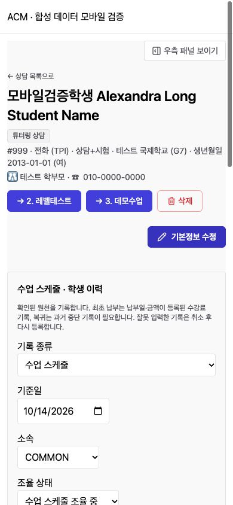
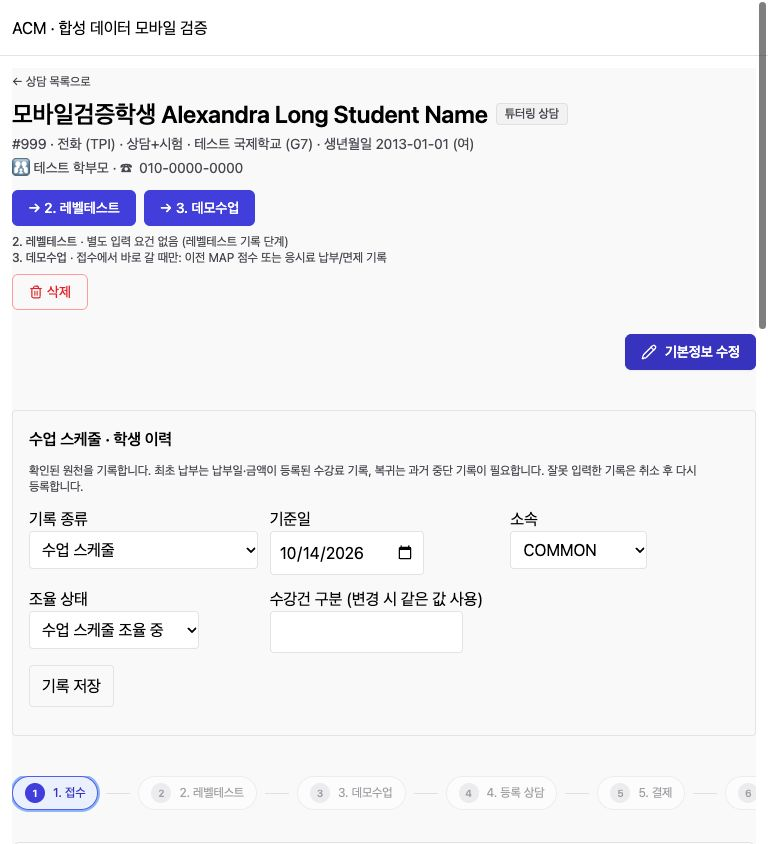

# Admin Mobile Follow-up (관리자 모바일 추가 개선)

## 1. Result (결과)
상담 상세의 다음 단계 설명을 768px 미만에서 숨겼다. 단계 이름/전환 버튼과 서버 검증 오류는 유지한다. 상단 작업 버튼, 강사 배정, 첨부파일, MAP 신청/학교/수납 페이지 작업 행에 줄바꿈을 적용했다. 데모수업 등록·수정은 모바일 1열, 작은 태블릿 2열, 넓은 화면 4열로 배치한다. 수강등록 요약은 모바일에서 라벨과 값을 세로로 표시하며 단계 탭은 44px 터치 높이와 내부 가로 스크롤을 사용한다. 긴 베트남어 저장 버튼도 화면 안에서 줄바꿈한다.

## 2. Verification (검증)
- `npm run build --prefix frontend-acm`: TypeScript + Vite 성공. 기존 500KB 번들 크기 경고만 존재.
- `git diff --check`: 통과.
- 로컬 Chrome 합성 데이터 fixture 사용. 운영 API/학생 데이터 변경 없음.
- 상담 접수: 320/360/390/430/767/768/1024/1280px 모두 문서 가로 넘침 없음. 설명은 767px까지 숨김, 768px부터 표시.
- 상담 7단계: 320px 모두 가로 넘침 없음. 수정 전 데모수업 477px, 수강등록/수강중 353px, 접수 328px까지 넘침 재현 후 해결.
- 한국어/영어/베트남어/중국어 접수: 320px 점검. 베트남어 392px 넘침 수정 후 320px 확인.
- MAP 신청/학교/학생/강사 목록: 320px 빈 목록 및 필터/작업 버튼 렌더링 확인. 상담 기본정보 수정 열기/취소 390px 확인.
- 모바일 단계 전환 요청 오류가 설명 숨김과 무관하게 표시되는지 합성 400 응답으로 확인.
- 수납 통계: 390px에서 3개 그래프 제목의 Y 좌표가 동일하며 내부 가로 스크롤을 유지. 통계 닫기 후 보기 버튼 표시 확인.

## 3. Audit Coverage (조사 범위와 한계)
| 영역 | 조사 결과 |
|---|---|
| 상담 상세/학교/MAP 신청/수납 작업 행 | 위 재현 및 수정. 상담 패널, 버튼, 입력, 첨부파일 중심 |
| 학생·강사 목록 | 브라우저 합성 빈 목록 검증. 학생 상세의 기존 반응형 그리드와 버튼 줄바꿈 코드 확인 |
| 학부모·수강·고객불만·대시보드 | 작업 행 줄바꿈과 표 내부 가로 스크롤 코드 확인. 실데이터 동선 미검증 |
| 직원·수업·캘린더·게시글·Q&A·설정 | 기존 반응형 배치/표 스크롤 코드 조사. 이번 변경 없음, 실기기 전체 동선 미검증 |
| 채팅·알림 및 공용 패널/모달 | 이전 모바일 개선을 유지. 이번 작업에서 실시간 채팅/푸시·모바일 키보드 재검증 안 함 |
| 자료·문항 등 기타 세부 화면 | 공통 레이아웃 외 개별 동선 검증 미완료. 전체 페이지 최적화 완료로 판정하지 않음 |

iOS Safari/Android 실기기, 실제 운영 상담, 긴 실데이터 목록, 전체 모달 조합은 미검증이다. 테스트 fixture는 전체 API를 합성 응답으로 처리하므로 서버 기능 검증을 대체하지 않는다. 수납 그래프를 모바일에서 세로로 쌓지 않는다. 운영 배포는 미실행.

## 4. Evidence (화면 증빙)
합성 데이터 화면이며 실제 학생 정보가 아니다.

