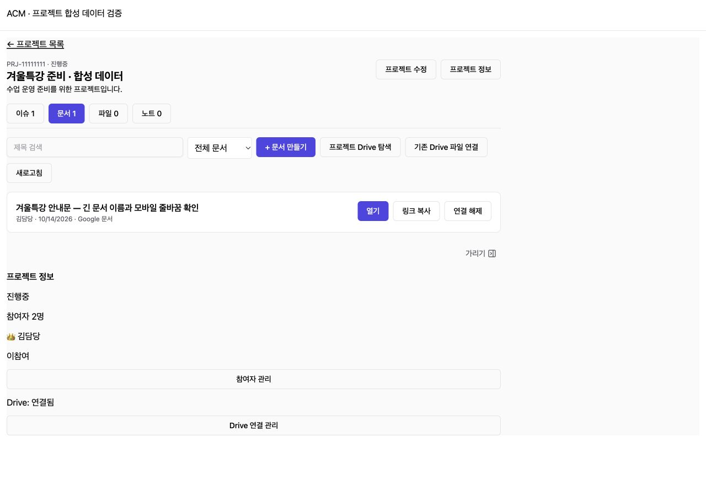
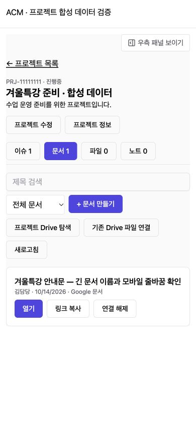
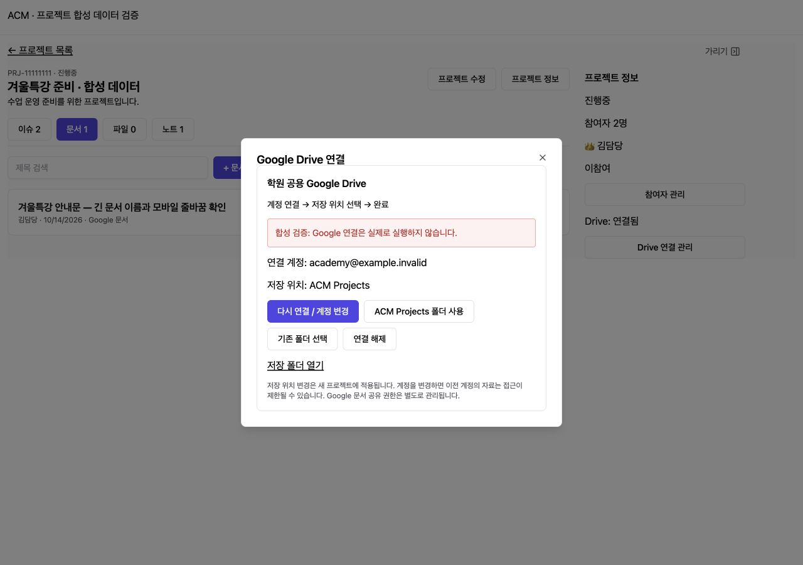

# Projects and Google Drive (프로젝트·Google Drive 구현)

## 1. Result (구현)
- 좌측 프로젝트 메뉴, 직접 생성/수정/보관, 담당자와 참여자 관리. 테넌트 및 참여자 접근 검사.
- 이슈 등록/수정/상태·담당자·기한, 노트 작성/수정, 검색과 탭 URL 유지.
- Google Docs/Sheets 생성, 파일 업로드(20MB), 기존 파일 연결, 프로젝트 폴더 탐색/하위 폴더 생성, 목록/카드·정렬. Google 원본을 삭제하지 않는 연결 해제.
- 공용 계정 OAuth 설정, 루트 폴더 기본 생성/선택, 재연결/해제. 미설정·만료·권한 오류 안내.
- 우측 정보 패널 및 모바일 모달. 기존 채팅 패널 구조 유지.
- OAuth state 일회성+10분 만료+PKCE+브라우저 쿠키 바인딩, callback 시 설정 권한 재검사. refresh token AES-GCM 암호화, 관리자 Picker 단기 access token만 no-store 제공. 일반 참여자는 공용 token 접근 불가.
- 생성 작업 DB 기록과 요청 내용 해시 검사, 불확실한 외부 생성 결과 자동 재생성 금지. 재시도 시 기존 Google 파일 조회.

## 2. Validation (검증)
- Backend TypeScript / Nest build 통과.
- 신규 모듈 ESLint 오류·경고 없음.
- Frontend TypeScript / Vite build 통과. 기존 번들 크기 경고만 존재.
- PostgreSQL 16 Testcontainers 9개 통합 테스트 통과: SQL 반복 적용, 테넌트/참여자 검증, 담당자 전용 수정, OAuth 권한/만료/재사용/브라우저 불일치, 암호화 저장, 중복 생성/불확실한 응답 회수/명시적 거부 후 재시도, 프로젝트 외 폴더 차단, 연결 해제/보관 보존.
- 기존 메뉴 설정 테스트 7개 통과. 기존 CI의 ACM 통합 테스트 수집 대상에 신규 테스트가 포함된다. 기존 전체 통합 단계는 continue-on-error 설정이므로 녹색 CI만으로 통합 테스트 통과를 판단하지 않는다. GitHub 인증의 workflow scope 부재로 워크플로 변경은 포함하지 않았다.
- 로컬 Chrome 합성 fixture: 제안 없는 프로젝트 생성→상세, 이슈/노트 작성, Google 문서/시트 선택 폼, Drive 연결 오류 안내, 일반 참여자 관리/Picker 버튼 숨김.
- 문서 탭 320/390/768/1280px 문서 가로 넘침 없음. 모바일 정보 패널 열기/닫기 확인.

## 3. Limits and Deployment (검증 한계·배포)
운영 미배포, 실제 Google OAuth 동의/Docs/Sheets 생성/공유 드라이브 접근/실파일 업로드는 미실행. Google 통신은 통합 테스트에서 mock으로 검증했으며 실제 앱 설정 후 [운영 설정 절차](../deployment/SETUP-261014-project-google-drive.md)의 연결 검증이 필요하다. 브라우저 테스트는 메모리 내 합성 응답으로 실제 API 저장 검증을 대체하지 않는다. iOS/Android 실기기 미검증.

SQL 1032와 OAuth 환경변수 5개를 배포 시 적용한다. 실제 공용 계정 인증은 계정 소유자가 수행한다. Google 파일 공유 권한은 ACM 권한과 별개로 유지한다. 기존 파일 전체 동기화/영구삭제 없음. 신규 UI 본문은 한국어 기준이며 좌측 메뉴명은 기존 4개 locale에 추가했다.

## 4. Evidence (합성 화면)

