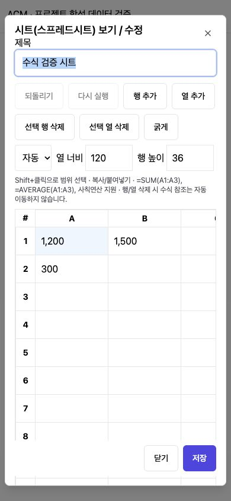

# Project Workspace Revision (프로젝트 문서·독립 Drive 개편)

## 1. Result (구현 결과)
- ACM 좌측 기본 메뉴 `/admin/drive` 추가. 프로젝트 없이 공용 폴더 연결·탐색·파일 업로드·폴더 생성 가능. 이전 `/admin/config/drive`도 같은 화면으로 호환.
- CONFIG_ADMIN이 계정/공용 폴더 연결과 공유 대상을 관리한다. 운영자 또는 선택 사용자별 열람/편집 권한을 서버에서 검사한다. 기본은 공유 안 함. 프로젝트 폴더와 겹치는 공용 폴더 등록 차단, 탐색/열기에서도 프로젝트 자료를 보호한다.
- 프로젝트 탭 **개요 | 문서 | 이슈**. 기본 개요에 설명·담당자·참여자·이슈 통계·최근 수정 문서.
- 문서 하위 **메모 | 시트(스프레드시트) | 문서(Docs) | 파일**. 이전 notes/files URL 호환.
- 메모 리치에디터, 문서 내부 작성·표 삽입/행열 편집. 기존 Tiptap과 MIT TableKit 3.28.0 사용. [공식 TableKit 사용법](https://tiptap.dev/docs/editor/extensions/nodes/table)을 확인했다.
- 내부 시트: 셀 입력, 범위 선택·복사/붙여넣기, 행열 추가·삭제·크기 변경, 굵게/숫자/문자 서식, 실행 취소/재실행, SUM/AVERAGE·사칙연산. 별도 상용 시트 라이브러리 없이 제한된 수식 파서를 사용하며 JavaScript eval을 사용하지 않는다.
- Google Sheets/Docs 링크 등록은 OAuth 없이 가능. 직접 작성과 구분하며 Google에서 원본 열기 제공. 기존 Google 신규 생성·파일 업로드는 OAuth가 필요하다.
- revision 기반 동시 수정 충돌 검사, 변경 후 이탈 확인, 본문 JSON/URL 검증. Google 파일 연결 해제는 원본 보존. 업로드/폴더 생성은 불확실한 응답 재시도 시 같은 작업 식별자를 유지한다.

## 2. Data Compatibility (데이터 호환)
- SQL `1033-project-workspace.sql`: 문서 종류·저장 방식·본문 JSON·링크·revision 추가. 기존 ID, 평문, 작성자, Google 참조 유지.
- 기존 NOTE→MEMO, Google MIME 기반 SHEET/DOC, FILE→FILE. 기존 평문은 편집기에서 문자로 읽어 안전하게 변환한다.
- 공용 폴더/사용자 권한만 `amb_acm_drv_folder`, `amb_acm_drv_member`에 신규 저장. 기존 학원 공용 OAuth 저장소는 단일 유지.
- 현재 운영 데이터/Google 계정/파일은 변경하지 않았다. 운영 반영 시 1033 마이그레이션 필요.

## 3. Validation (검증)
- 프론트엔드 TypeScript/Vite 및 백엔드 Nest 빌드 통과. 기존 번들 크기 경고 존재.
- PostgreSQL 16 Testcontainers: 12개 통합 테스트 통과. 기존 9개 회귀 검증과 문서/평문 보존·revision 충돌·링크/본문 검증·공용 폴더 ACL/프로젝트 보호 추가. 1033 반복 적용 검증.
- 시트 모델 Node 테스트 7개 통과: 수식 우선순위, 범위/함수, 순환·참조 오류, 0 나눗셈·코드 실행 구문 거부, 문자 형식, 숫자 표시, 과도한 계산 중단.
- 기존 테넌트 메뉴 테스트 7개 통과. 총 26개.
- 로컬 합성 fixture: 개요·탭 순서, 메모 굵게 저장 후 재열기, 시트 1200+300 SUM 결과 1500 저장 후 재열기, 문서 표 생성 후 재열기 확인.
- 모바일 390px 시트: 문서 폭 390px, 다이얼로그 374px, 표 내부 스크롤. 아래 캡처는 실제 학생 데이터가 없는 합성 화면이다.
- 추가 검증 중 브라우저 연결이 끊겨 최종 독립 Drive 화면, Google 링크 등록 화면 및 다른 화면 크기의 후속 UI 검증은 미완료. 서비스 권한/링크 저장은 통합 테스트로 검증했다. 임시 viewport 해제도 도구 연결 복구 후 확인 필요.

## 4. Limits (범위·제한)
- 실제 Google OAuth, 파일 업로드/생성은 미실행. 운영 OAuth 설정 5개는 이전 배포 확인 시 미설정이었다.
- 내부 시트는 단일 워크시트, 최대 200행/50열, 본문 JSON UTF-8 60KB 한도. 행/열 삭제 시 수식 참조는 자동 이동하지 않으며 화면에 안내한다. 고급 Excel 호환·실시간 공동 편집·Google 양방향 동기화는 제외.
- Google 비공개 링크는 해당 사용자의 Google 권한으로 열린다. 공개 공유를 강제하거나 자동 권한을 부여하지 않는다.
- 공용 폴더 연결 대상은 Google drive.file/Picker가 허용하는 범위다. 공용 폴더 내 자료는 지정한 열람/편집 대상에게 공유되며 기존 프로젝트 폴더는 자동 공개하지 않는다.
- 최초 화면/내부 작성에는 Google 연결이 필요 없다. Google 파일 생성·업로드는 연결 후 사용한다.

## 5. Evidence (화면 증빙)

