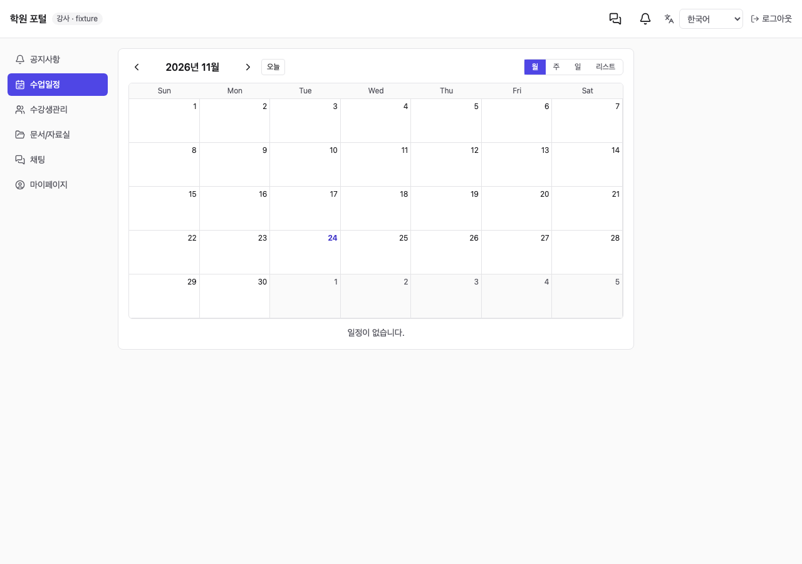
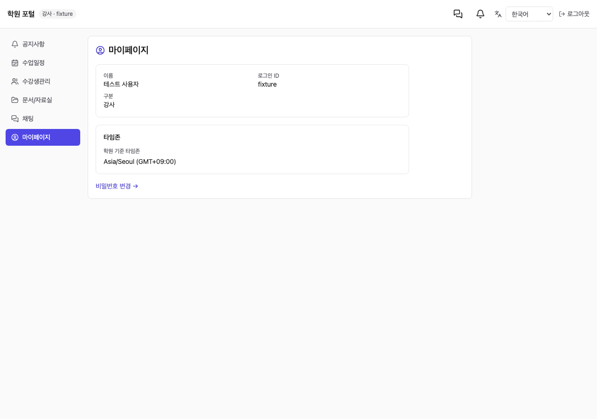
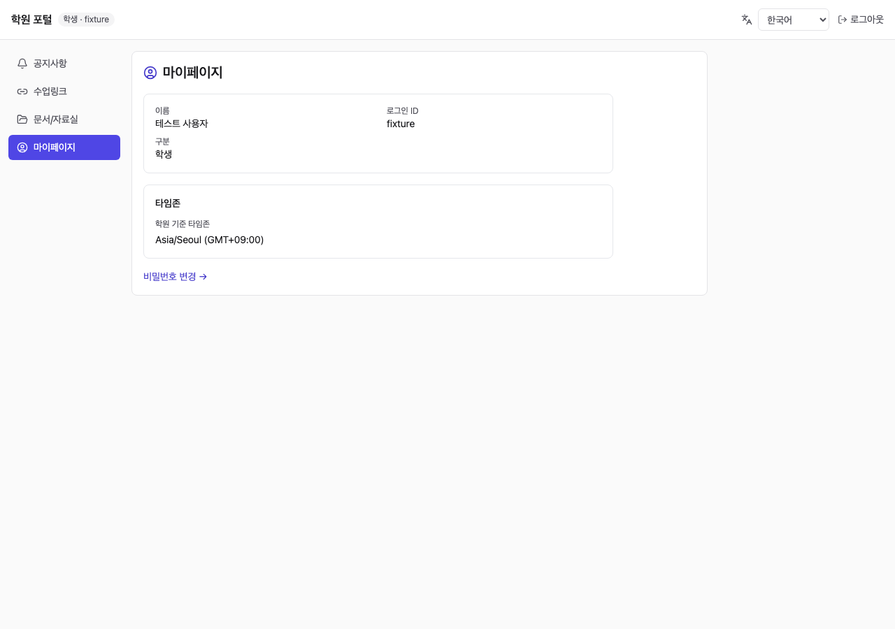
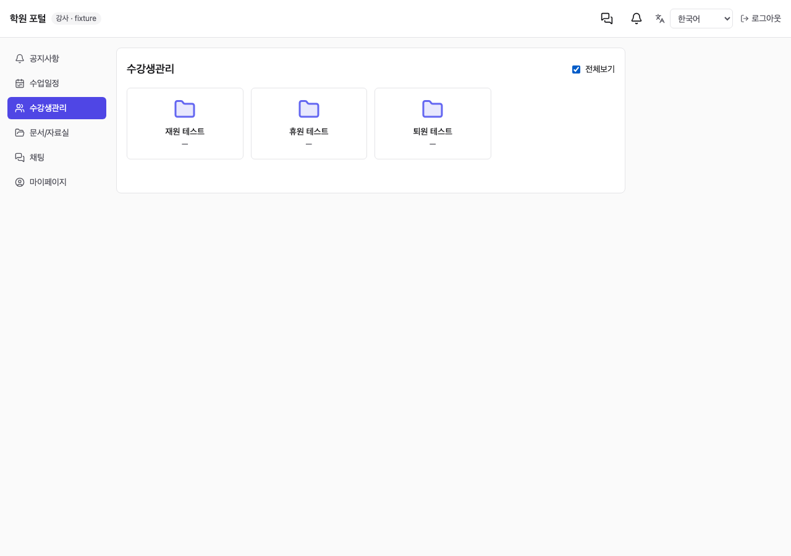
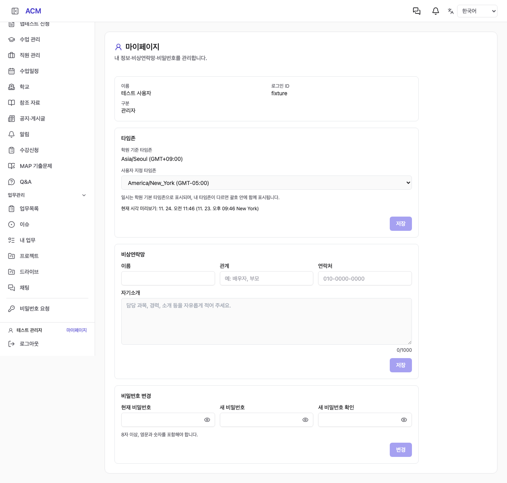
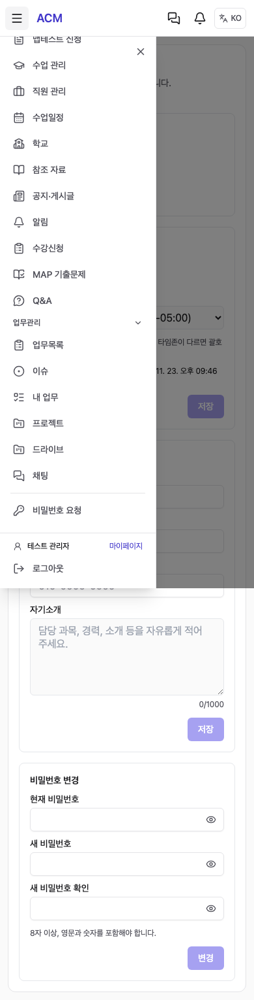

# Portal Visibility Implementation (포털 노출·목록·메뉴 구현)

## 1. Result (결과)

Implemented the approved [plan](../plan/PLN-261124-teacher-portal-calendar.md) on branch `feat/portal-visibility-261124`, based on `origin/main` (`bc2803c`).
기존 작업 폴더의 변경은 보존하고 `/private/tmp/acm-portal-261124`의 별도 작업 트리에서 구현했다. 운영 배포·운영 데이터 변경은 수행하지 않았다.

| Requirement (요구사항) | Result (구현 결과) |
| --- | --- |
| Teacher-only calendar | 강사 메뉴에 수업일정 복원. 학생·학부모의 캘린더 목록 직접 URL은 공지사항으로 이동하며 캘린더 목록 API를 호출하지 않음 |
| Custom timezone | `/portal/me` 강사·학생의 사용자 지정 선택·설명·미리보기·저장 버튼 숨김. 학원 기준 시간대 표시·기존 저장값 유지 |
| Withdrawn students | 기본 목록/API 조회에서 WITHDRAWN 제외. 전체보기에서만 포함. INACTIVE는 유지. 전체보기에서도 본인 관련 학생 범위 유지 |
| Work navigation | 업무목록 → 이슈 → 내 업무 → 프로젝트 → 드라이브 → 채팅. 저장된 이전 순서에도 적용. 다른 그룹 순서·사용자 메뉴·개별 숨김 조건 유지 |

**Menu interpretation (메뉴 대응):** The current source has a `documents` menu but no separate built-in work-list menu. 기존 `/admin/documents` 메뉴를 업무목록으로 표시해 맨 위로 이동했다. 문서 기능·URL은 유지한다. 이 해석은 작업 중 사용자에게 알렸으며 별도 확인 질문의 답변은 아직 없다.

## 2. Implementation (구현 내용)

- `portal-shell.tsx` exposes the calendar only for TEACHER; `PortalCalendarPage` checks role before mounting the query component. Calendar cache is scoped by tenant/teacher. 일정 없음과 조회 오류를 구분하고 재시도 버튼을 추가했다.
- Student/parent event details used by other features retain existing permissions. 상세의 돌아가기 링크는 강사는 캘린더, 학생·학부모는 수업링크로 연결한다. 캘린더 목록 숨김을 기존 모든 일정 API 권한의 폐기로 확대하지 않았다.
- `MyProfilePage` hides custom timezone editing for teacher/student portal sessions. 학부모·운영 콘솔의 타임존 설정은 기존대로 동작한다.
- `GET /api/portal/teacher/students?includeWithdrawn=true` includes related withdrawn students; default/false excludes them. NestJS validates the boolean flag. 필터는 파라미터 SQL로 적용하고 로그인 사용자의 tenant/teacher 범위를 그대로 사용한다.
- Detail authorization explicitly includes withdrawn students within the existing relationship scope, independent of the default display filter. 목록 캐시 키에는 테넌트·강사·전체보기 조건을 포함한다.
- Frontend/backend canonical menu defaults are aligned. `AppShell` normalizes only the six built-in work entries, preventing old saved order from overriding the request.
- Korean, English, Vietnamese, and Simplified Chinese labels are included.

## 3. Verification (검증)

| Check (검사) | Result (결과) |
| --- | --- |
| Frontend `npm run build` | PASS — TypeScript + Vite production build |
| Backend `npm run build` | PASS — NestJS build |
| Backend `npm test -- --runInBand portal-teacher-students` | PASS — 2 suites, 14 tests |
| Python Playwright smoke | PASS — 7 scenario groups, synthetic API fixtures |
| Locale keys / `git diff --check` | PASS |

Backend tests cover boolean default/true/false, invalid query values, student/parent rejection, authenticated tenant/teacher arguments, default SQL status filtering, and related withdrawn-student detail access. DB 연결 없이 실행한 단위·HTTP 계약 테스트이며 실제 데이터베이스에서 SQL 실행은 검증하지 않았다.

Browser checks cover teacher calendar menu/direct URL/trailing slash/refresh and month/week/day/list, student/parent redirect without calendar requests, teacher/student timezone hiding, unchanged parent/console timezone editing, error/retry, ACTIVE/INACTIVE default visibility, WITHDRAWN all-view/detail, default reset after returning, and desktop/mobile order with old saved order and hidden drive.

All API responses in browser tests are synthetic; no production credentials or student information were used. ブラウザ検証は合成データで実施した。Viteには既存の大きいチャンク警告があるがビルドは成功した。運用サイトは接続不可のためログイン検証していない。

Reproduce the browser check with the installed Python Playwright and local dependencies:

```sh
cd frontend-acm
# Terminal 1
npm run dev -- --host 127.0.0.1 --port 3009 --strictPort
# Terminal 2
python3 test/portal-visibility.smoke.py
```

## 4. Screenshots (화면 확인)

The following captures use test fixtures. 아래는 합성 데이터로 확인한 화면이다.








## 5. Delivery (전달)

Changes are implemented locally on the feature branch. 운영 반영 전에는 이 브랜치를 통상적인 리뷰·배포 절차로 적용하고 실제 강사·학생 계정에서 재확인해야 한다. DB migration is not required. 데이터베이스 스키마 변경은 없다.
