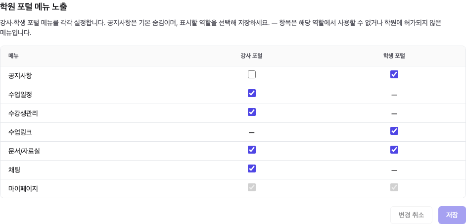
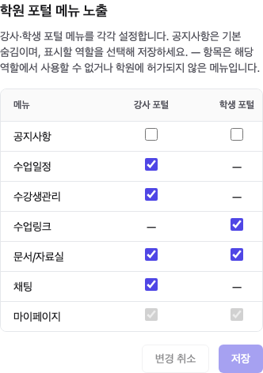
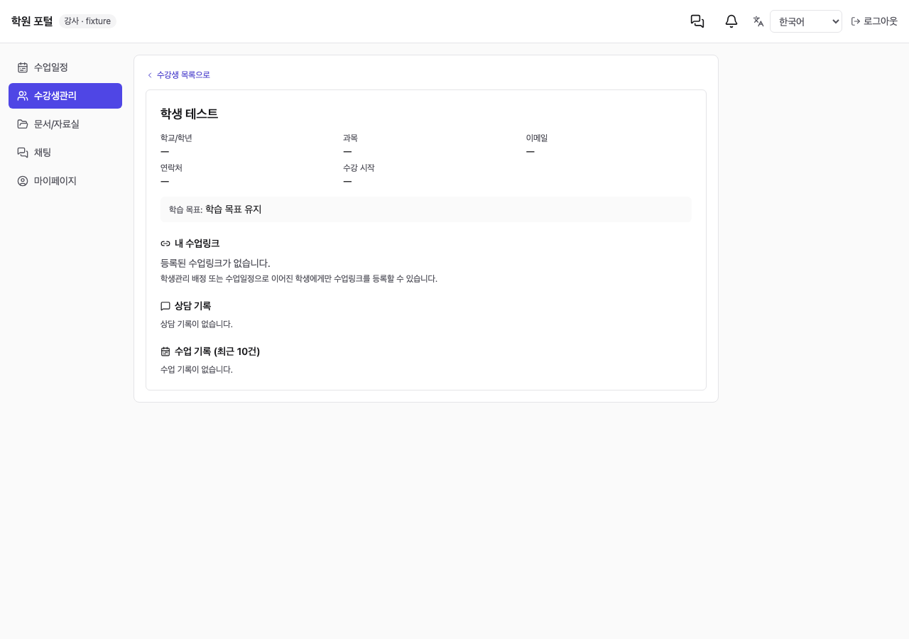

# Portal Menu Visibility Implementation (포털 메뉴 노출 구현)

## 1. Result (구현 결과)

Implemented the approved [plan](../plan/PLN-261125-portal-menu-visibility.md) in branch `feat/portal-menus-261125`, based on deployed main `7ece5a6`.
별도 작업 트리 `/private/tmp/acm-portal-menus-261125`에서 구현했다. 기존 작업 폴더의 변경을 보존했고, 운영 코드·DB·설정은 변경하지 않았다.

| Requirement (요구사항) | Result (결과) |
| --- | --- |
| Student special note | 포털 수강생 상세에서 라벨·본문·응답 타입·API 필드·조회 컬럼을 제외. 학습 목표는 별도로 유지하고 내용 없는 카드는 표시하지 않음 |
| Separate portal menus | 테넌트 설정 메뉴 탭에 강사 포털 / 학생 포털 매트릭스 추가. 콘솔 ADMIN/TEACHER/STAFF 설정과 저장 영역 분리 |
| Notice settings | 강사·학생 공지 초기 숨김. 각 역할별로 독립적인 켜기·끄기 가능. 숨김 시 목록·상세 직접 진입 및 인증 공지 API 제한 |
| Tenant-specific content | 인증된 포털 세션의 테넌트로 PUBLISHED NOTICE 목록·상세 조회. 다른 학원의 동일 slug와 혼동하지 않음 |
| Role limits | 학생에게 강사 전용 캘린더·수강생관리·채팅을 열 수 없음. 마이페이지 고정 노출 |
| Navigation refresh | 계정·테넌트·역할별 캐시, 설정 저장 후 갱신, 탭 간 BroadcastChannel 알림, 15초 polling fallback |

## 2. Implementation (구현 내용)

### 2.1 Data and API (데이터·API)

- Migration: `sql/acm/1071-tenant-portal-menu.sql` creates `amb_acm_tenant_portal_menu`, UUID PK, tenant FK, role/menu checks, unique tenant/kind/key, and updated-at trigger. Boolean column uses `tpm_is_visible` to follow the PG boolean naming standard.
- `GET/PUT /api/acm/tenant/portal-menus`: existing authentication, own-tenant, tenant-master, and password-rotation guards. Entire payload is validated before transactional writes; fixed/locked menus and duplicate pairs are rejected.
- `GET /api/portal/me/menus`: real portal JWT validation, deriving tenant and kind from the active account.
- `GET /api/portal/posts/notices` and `.../:slug`: authenticated tenant scope and effective notice setting. Hidden notices return 403. Detail also rejects draft, missing, foreign-tenant, or non-NOTICE posts.
- Existing system-level tenant entitlements remain an upper limit for posts/calendar/students/chat. Console role hiding is separate from the explicit portal settings.

### 2.2 Screens (화면)

- Tenant settings shows separate console and academy portal sections, with independent draft/save state and fixed/locked controls.
- Portal shell and page guards apply effective visibility before mounting data queries, including nested notice/material/student routes. The header chat link is hidden with the chat menu.
- `/portal` chooses the first permitted menu; if all optional menus are off, it goes to `/portal/me`.
- Settings load failures do not expose all menus; retry is provided. Settings update subscription is mounted once in the portal shell.
- Student event details remain available through class links, within their existing access scope, independently of the teacher-only calendar list.
- Learning goals, consultation records, class links, and stored special-note/admin data are preserved. Parent menu configuration is outside this change; parent legacy navigation remains available.
- Public homepage `/portal/news` and console post management remain separate from authenticated portal notices.
- Korean, English, Vietnamese, and Simplified Chinese copy is included.

## 3. Verification (검증)

| Check (검사) | Result (결과) |
| --- | --- |
| Backend build | PASS — NestJS build |
| Frontend build / type check | PASS — TypeScript + Vite |
| New PostgreSQL integration suite | PASS — 17 tests |
| Existing student service / HTTP tests | PASS — 14 tests |
| New Playwright UI scenarios | PASS — 9 scenario groups |
| Previous portal visibility regression | PASS — 9 scenario groups |
| New backend files lint / diff check | PASS |

PostgreSQL checks use a disposable Testcontainers database and actual migration files. They cover new-schema installation, migration replay with existing settings, save/reload, all four teacher/student notice combinations, tenant isolation, fixed/locked/duplicate/invalid inputs, atomic rejection without partial writes, real tenant-master permission checks, real portal JWT authentication, setting changes affecting existing tokens, published NOTICE scoping, and preservation of public news.

Student unit verification confirms `specialNote` is absent even when a test row includes a private note. Browser checks deliberately return an extra special-note fixture field and confirm neither its label nor value renders, while learning goals remain and empty cards disappear.

Browser checks also cover cross-tab settings updates, direct hidden notice detail, all menus off, settings error/retry, correct portal token routing, desktop/mobile matrix, and previous calendar/timezone/student-list/work-link behavior. All UI responses and identities are synthetic.

Vite reports the existing large-chunk warning; production build succeeds. Remote CI and real production-account validation have not been run for this new branch.

## 4. Reproduce (재현)

```sh
cd backend
npm test -- --runInBand portal-teacher-students
npm run test:int -- --testPathPatterns=it-portal-menus.int-spec.ts
npm run build
```

The integration suite needs local Docker and the existing `tac-postgres-acm:pg16-bigm` image. 브라우저 테스트는 로컬 프론트와 Python Playwright를 사용한다.

```sh
cd frontend-acm
npm run build
# Terminal 1
npm run dev -- --host 127.0.0.1 --port 3009 --strictPort
# Terminal 2
python3 test/portal-menus.smoke.py
python3 test/portal-visibility.smoke.py
```

## 5. Screenshots (화면 확인)





## 6. Deployment (배포)

Not deployed. Future deployment must apply migration 1071 before the new backend is served, then deploy the aligned frontend/backend. New teacher/student portal notices start hidden and can be enabled separately by the tenant master.

이번 구현 승인은 이전 운영 배포 승인을 재사용하지 않는다. 운영 배포 요청 시 일반 CI·스테이징·운영 배포 절차와 실제 설정 확인을 수행한다.
